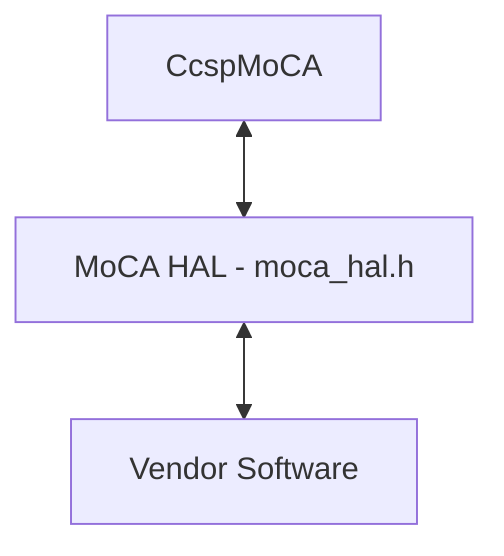
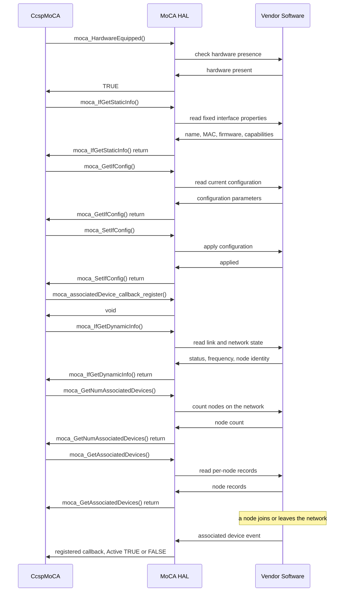
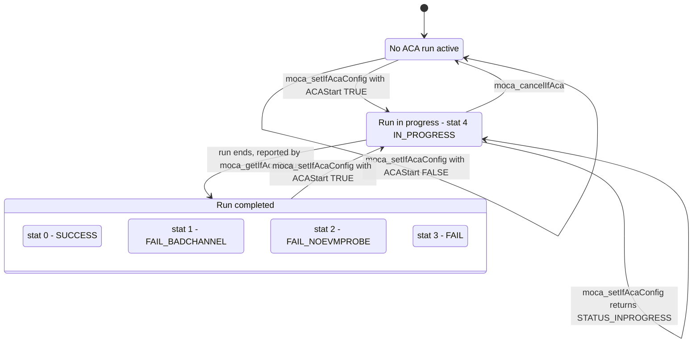

# MoCA HAL Documentation

## Version History

| Date | Comment | Version |
| --- | --- | --- |
| 2024-07-29 | Initial release of the MoCA HAL interface definition — `RDKB-52502` MoCA HAL header migration to GitHub, `moca_hal.h` update, and refinement following MTA HAL review comments. | 1.0.0 |
| 2026-08-24 | Rewritten against the canonical HAL specification topic set. Page renamed from `MoCAHalSpec.md` to [halSpec.md](halSpec.md). Added `Version History`, `Optional Components`, `Data Structures and Defines`, `API Surface` and `State Diagram`; documented the asynchronous notification callback against the header for the first time; corrected the API narrative so that every named identifier is one the header declares. | 1.0.1 |

## Acronyms

- `ACA` \- Automatic Channel Adaptation
- `CPE` \- Customer Premises Equipment
- `EVM` \- Error Vector Magnitude
- `HAL` \- Hardware Abstraction Layer
- `MoCA` \- Multimedia over Coax Alliance
- `NC` \- Network Coordinator
- `OEM` \- Original Equipment Manufacturer
- `PHY` \- Physical Layer
- `PQoS` \- Priority Quality of Service
- `RDK-B` \- Reference Design Kit for Broadband Devices
- `SCMOD` \- Subcarrier Modulation

## Description

The diagram below shows the high-level software architecture of the MoCA HAL module stack.

The MoCA HAL provides a standardized interface through which RDK-B middleware accesses and controls
MoCA network adapters, independently of the underlying hardware or vendor implementation. Its caller
is `CcspMoCA`, the RDK-B middleware component that owns the MoCA interface; "the caller" in this
document means that component.

This repository carries the **interface definition only**. `include/moca_hal.h` declares 21
functions and the data types they exchange; each vendor or `OEM` ships its own implementation behind
that contract as a shared library.

For a caller, the interface covers five things:

- **Interface configuration:** read and write the frequency mask, channel scanning, privacy
  passphrase, power limits and bandwidth thresholds of a MoCA interface.
- **Interface information:** static properties that do not change while the interface is up
  (firmware version, MAC address, capability masks) and dynamic properties that do (link status,
  operating frequency, `NC` node identity, connected client count).
- **Statistics and counters:** network-layer, MAC-layer, aggregate and `PQoS` flow statistics, the
  full mesh `PHY` rate table, and the module reset count.
- **Associated devices:** enumerate the nodes on the MoCA network, and receive an asynchronous
  notification when one joins or leaves.
- **Automatic Channel Adaptation:** configure, start, cancel and read back an `ACA` run, plus the
  `SCMOD` statistics it produces.

## Optional Components

The following parts of the interface are optional; every other part is mandatory.

- **The `MOCA_VAR`-conditional surface:** `moca_GetFullMeshRates`, the `moca_mesh_table_t` structure
  it fills, `moca_if_status_t` and `moca_dynamic_info_t` are declared only when `MOCA_VAR` is not
  defined, the only build in which the shipped header compiles
  (`Platform or Product Customization`).
- **The associated-device notification callback:** A caller that polls `moca_GetNumAssociatedDevices`
  and `moca_GetAssociatedDevices` need not register one with
  `moca_associatedDevice_callback_register`; a caller that does receives node join and leave events
  asynchronously.

## Component Runtime Execution Requirements

The requirements in this block apply to every implementation of this interface. Failure to meet them
will result in undefined behaviour in the calling middleware.

### Initialization and Startup

**This interface has no initialization or teardown call, session or handle:** The vendor brings the
MoCA hardware and software into a usable state in its own start-up path. A caller's normal bring-up
order is then:

- `moca_HardwareEquipped()` \- confirm that MoCA hardware is present and correctly configured before
  calling anything else.
- `moca_IfGetStaticInfo()` \- read the interface name, MAC address, firmware version and capability
  masks, which do not change while the interface is up.
- `moca_GetIfConfig()` \- read the configuration currently in force.
- `moca_SetIfConfig()` \- apply the configuration: frequency band, channel, privacy and power
  settings.
- `moca_associatedDevice_callback_register()` \- register the notification callback, if the caller
  wants node join and leave events rather than polling for them.
- `moca_IfGetDynamicInfo()` \- read link status and the current operating state.
- `moca_IfGetStats()`, `moca_GetNumAssociatedDevices()` and `moca_FreqMaskToValue()` \- routine
  monitoring and mask interpretation thereafter.

Third party vendors will implement appropriately to meet operational requirements.

### Threading Model

Vendors may implement internal threading and event mechanisms to meet their operational
requirements. These mechanisms must be designed to ensure thread safety when interacting with the HAL
interface. Proper cleanup of allocated resources (e.g., memory, file handles, threads) is mandatory
when the vendor software terminates or closes its connection to the HAL.

This interface is not inherently required to be thread-safe. It is the responsibility of the caller
to ensure that all interactions with the APIs are properly synchronized: concurrent calls from more
than one thread, and state shared with the notification callback, must be serialized by the caller.
`Asynchronous Notification Model` states the obligations on the callback itself.

### Process Model

All APIs are expected to be called from multiple processes. Due to this concurrent access, vendors
must implement protection mechanisms within their API implementations to handle multiple processes
calling the same API simultaneously. This is crucial to ensure data integrity, prevent race
conditions, and maintain the overall stability and reliability of the system.

### Memory Model

The caller owns the storage it passes to this interface's functions. Every function that produces
data writes it into storage the caller supplies; no function returns storage the caller must free,
and the interface has no allocator or release function. The record a notification callback receives
falls outside that ownership and is handled as `Caller Responsibilities` sets out.

#### Caller Responsibilities

- Allocate every output structure and array before the call, and release it with the caller's own
  allocator once it is no longer needed.
- Size arrays as the API documentation requires: `moca_GetMocaCPEs` needs `kMoca_MaxCpeList` (256)
  entries and `moca_GetFullMeshRates` an entry for every node pair.
- `moca_GetAssociatedDevices` and `moca_getIfScmod` take the address of a pointer the caller has set
  to its own array; that array remains the caller's to release.
- Treat every output value as invalid when the call that produced it fails.
- Keep the `moca_cfg_t` passed to `moca_SetIfConfig` and the `mask` array passed to
  `moca_FreqMaskToValue` valid after the call returns, and free or overwrite that storage only once
  the vendor implementation has established that it no longer uses it.
- Copy what is needed out of the `moca_associated_device_t` record a notification callback receives
  before the callback returns, and neither keep nor free that pointer.

#### Module Responsibilities

- Modules must allocate and de-allocate memory for their internal operations, and release all
  internally allocated memory upon closure to prevent resource leaks.
- All strings used in this module must be zero-terminated, so that string functions can determine
  their length and buffer overflows are prevented.

### Power Management Requirements

The MoCA HAL is not involved in any power management operation. The transmit power members of
`moca_cfg_t` — `TxPowerLimit`, `BeaconPowerLimit` and `AutoPowerControlEnable` — are MoCA radio
transmission settings, not device power states.

### Asynchronous Notification Model

This interface has one asynchronous notification, the associated-device event; every other call is
synchronous.

- **Registration:** `moca_associatedDevice_callback_register` installs a
  `moca_associatedDevice_callback`. It returns `void`, and there is no de-registration call.
- **Trigger and payload:** the callback, `INT (*)(ULONG ifIndex, moca_associated_device_t *moca_dev)`,
  is invoked whenever a MoCA client is activated or deactivated on the network. `ifIndex` identifies
  the interface; the `Active` member of the record is `TRUE` for an activation and `FALSE` for a
  deactivation, and the other members carry the node's identity and link characteristics.
- **Return value:** the callback returns an `INT` status for its own handling of the event. The value
  cannot request redelivery; a callback with nothing to report returns `STATUS_SUCCESS`.
- **Callback obligations:** the callback tolerates being invoked on any thread and at any point
  relative to the caller's own calls. It completes quickly, does not block, checks `moca_dev` for
  `NULL`, synchronizes state it shares with the caller's other threads, and calls back into the
  interface only where the vendor implementation supports it.
- **Membership:** a caller that needs a complete picture of the network reads it with
  `moca_GetNumAssociatedDevices` and `moca_GetAssociatedDevices` rather than relying on notifications
  alone.

### Blocking calls

- **Synchronous and Responsive:** every API operates synchronously, returns its outcome directly and
  completes within a reasonable time for the operation.
- **Non-Blocking Requirement:** given the single-threaded environment in which these APIs are called,
  they must not block or suspend the caller's main thread; implementations avoid long-running
  operations or use asynchronous mechanisms internally.
- **Timeout Handling:** implementations apply appropriate timeouts to operations that can fail
  through lack of response.
- **Start-up:** the non-blocking requirement applies once the vendor MoCA subsystem is ready. Before
  then a call may not return promptly, so the caller bounds its first calls.
- **Automatic Channel Adaptation:** an `ACA` run is long-running, but no call waits for it: `moca_setIfAcaConfig` starts the
  run and returns, and the caller polls `moca_getIfAcaStatus` for completion.

### Internal Error Handling

**Synchronous Error Handling:** every status-returning API reports its outcome synchronously as its
return value. `moca_HardwareEquipped` (`BOOL`), `moca_FreqMaskToValue` (a frequency value) and
`moca_associatedDevice_callback_register` (`void`) return no status; every other function returns
one of these codes.

| Code | Value | Meaning and caller action |
| --- | --- | --- |
| `STATUS_SUCCESS` | `0` | The operation succeeded and any output has been populated. |
| `STATUS_FAILURE` | `-1` | The operation failed, with no reason attached. Retry, fall back or report the failure; the cause is recorded in the vendor log described under `Logging and debugging requirements`. |
| `STATUS_NOT_AVAILABLE` | `-2` | The requested value or capability is not available. Treat it as a failure and do not read the outputs. |
| `STATUS_INPROGRESS` | `-1` | `ACA` only: a run is already in progress and no new one was started. Poll `moca_getIfAcaStatus` or cancel with `moca_cancelIfAca` rather than retrying immediately. |
| `STATUS_NO_NODE` | `-2` | `ACA` only: the specified node does not exist. Re-read the node set with `moca_GetAssociatedDevices` before retrying. |
| `STATUS_INVALID_PROBE` | `-3` | `ACA` only: invalid probe type. Correct the call to use one of the two `PROBE_TYPE` members. |
| `STATUS_INVALID_CHAN` | `-4` | `ACA` only: invalid channel. Correct the channel before retrying. |

**Two pairs of codes share a value:** `STATUS_INPROGRESS` equals `STATUS_FAILURE` (`-1`) and
`STATUS_NO_NODE` equals `STATUS_NOT_AVAILABLE` (`-2`). When `moca_setIfAcaConfig` returns `-1`, read
`moca_getIfAcaStatus` and its `stat` member to tell a run already in progress from a failure.

Treat any value other than `STATUS_SUCCESS` as a failure, including a value not listed above.

### Persistence Model

There is no requirement for the HAL to persist any setting information. The caller is responsible
for persisting any settings it needs.

Setting the `Reset` member of `moca_cfg_t` returns the MoCA configuration parameters to their
defaults; a caller re-applies any settings it has persisted afterwards.

## Non functional requirements

Following non functional requirement should be supported by the MoCA HAL component.

### Logging and debugging requirements

The component is required to record all errors and critical informative messages to aid in
identifying, debugging, and understanding the functional flow of the system. Logging uses `syslog`;
`printf` is discouraged unless `syslog` is not available. Log output is written to the
`moca_vendor_hal.log` file in the `/var/tmp/` or `/rdklogs/logs/` directory.

Log levels follow the Linux standard logging system, in descending order of severity: `FATAL`,
`ERROR`, `WARNING`, `NOTICE`, `INFO`, `DEBUG` and `TRACE`. Each log entry carries a timestamp, the
log level and a message describing the event or condition. Because `STATUS_FAILURE` carries no
reason, an `ERROR` entry identifies the operation that failed and why.

Implementations must not log credentials, secrets, security-sensitive information, or other sensitive data.
This applies at every log level, including `DEBUG` and `TRACE`, and to any trace buffer,
diagnostic dump or crash report the implementation produces.

### Memory and performance requirements

Memory ownership for the caller and the implementation is set out in `Memory Model`. The largest
fixed-size types a caller allocates are `moca_scmod_stat_t` (three 512-byte subcarrier arrays per
entry), `moca_aca_stat_t` (a 512-element power profile), and `moca_cfg_t` and `moca_static_info_t`
(several 128-byte frequency masks each). Array-returning calls are bounded by `kMoca_MaxCpeList`
(256) and `kMoca_MaxMocaNodes` (16).

### Quality Control

An implementation should pass analysis with third-party tools such as `Coverity`, `Black Duck` and
`Valgrind` without reported issues. Neither the HAL implementation nor the vendor software beneath it
may introduce memory leaks or memory corruption.

Any change to a file listed under `Source References` obliges a review of this document by the
repository maintainers, through the issue and pull-request process `CONTRIBUTING.md` describes.

### Licensing

The interface definition is licensed under the Apache License 2.0, with the full text in `LICENSE`
and the attribution notice in `NOTICE`. An implementation of this interface is expected to be
released under the Apache License 2.0.

### Build Requirements

The source code should be capable of, but not be limited to, building under the Yocto distribution
environment. The recipe should deliver a shared library named as `libhal_moca.so`. The toolchain,
compiler and build options are those of the vendor's own recipe.

### Variability Management

Changes to the interface are controlled by versioning. Vendors implement a designated version of the
interface and move to later versions as their service agreements require. Each interface version
follows [Semantic Versioning 2.0.0](https://semver.org/spec/v2.0.0.html), and vendor code complies
with a specific version.

`MOCA_VAR` is the single compile-time flag that changes this interface;
`Platform or Product Customization` states what it guards and which build is usable.

**The generated documentation describes the build in which `MOCA_VAR` is not defined:**
`docs/generate_docs.sh` passes ``DOXYGEN_EXTRA_PARAMS="PREDEFINED='MOCA_VAR=0'"``, but the pinned
generator, `1.2.0`, does not use that variable and leaves `PREDEFINED` empty. The generated reference
therefore includes the four `MOCA_VAR`-conditional symbols, as does every build in which the shipped
header compiles.

### Platform or Product Customization

The header guards four symbols with `#ifndef MOCA_VAR`, so defining `MOCA_VAR` excludes them:

- `moca_if_status_t` — the interface status values (`IF_STATUS_Up`, `IF_STATUS_Down` and the
  others).
- `moca_dynamic_info_t` — the dynamic interface information (status, last change, bandwidth maxima
  and the rest).
- `moca_mesh_table_t` and `moca_GetFullMeshRates` — the full mesh `PHY` rate table between nodes.

The `moca_IfGetDynamicInfo` declaration sits outside every `MOCA_VAR` guard and names
`moca_dynamic_info_t`, so with `MOCA_VAR` defined the shipped `moca_hal.h` is ill-formed:
compilation fails at that declaration inside the header, and guarding caller code under
`#ifndef MOCA_VAR` does not repair it. The usable build is the one in which `MOCA_VAR` is not
defined, which declares all 21 functions and their types.

## Interface API Documentation

The `moca_hal.h` header file provides a complete reference for all HAL function prototypes and data
type definitions. Each declaration carries a Doxygen block giving its per-parameter direction, valid
ranges, pre-conditions and return codes; this page indexes that detail rather than repeating it.

A caller takes two steps to use the MoCA HAL from its own component or process:

1. **Inclusion:** include the `moca_hal.h` header file in the calling source file.
2. **Linking:** establish a linker dependency on the `libhal_moca` library.

### Theory of operation and key concepts

The MoCA HAL abstracts the MoCA hardware and vendor software behind a standardized interface, through
which the caller configures, monitors and troubleshoots the MoCA interface.

Every call is a synchronous getter or setter addressed to an interface index; results are written
into caller-supplied storage and status is returned as the return value. The exceptions are the
associated-device notification (`Asynchronous Notification Model`) and the long-running `ACA`
process (`State Diagram`).

#### Object Lifecycles

- **Creation and destruction:** The MoCA HAL creates and destroys no objects; every structure
  its functions read or fill is caller-owned, as `Memory Model` sets out.
- **Usage:** The HAL's functions (`moca_GetIfConfig`, `moca_IfGetDynamicInfo` and the others)
  populate those structures, and the caller uses them to configure the interface, monitor its status
  and gather statistics.
- **Unique Identifiers:** `ifIndex` (`ULONG`) identifies a MoCA interface: 0 for a single interface,
  1 to 256 where several are present. The five `ACA` functions take the same index as
  `interfaceIndex` (`int`).

#### Method Sequencing

- **Configuration:** `moca_SetIfConfig` should generally be called before information is retrieved or
  other operations are performed. Because it takes a complete `moca_cfg_t`, a caller reads the current
  configuration with `moca_GetIfConfig`, changes the members it needs and writes the whole structure
  back; a structure populated from scratch overwrites every member the caller did not set.
- **Sizing before enumeration:** `moca_GetNumAssociatedDevices` is called before
  `moca_GetAssociatedDevices` so that the caller can size the array it supplies.
- **Ordering of `ACA` calls:** `moca_setIfAcaConfig` precedes `moca_getIfAcaStatus` and `moca_getIfScmod`. The
  status is meaningful once a run has been configured or started, and the `SCMOD` statistics once a
  run has completed.
- **Other methods:** the remaining functions can be called in any order, provided the caller
  serializes them as `Threading Model` requires.

#### State-Dependent Behavior

- **Interface status:** functions such as `moca_IfGetDynamicInfo` and `moca_IfGetStats` return
  different information depending on the current state of the MoCA interface (Up, Down, Dormant and
  the others).
- **The `ACA` process:** the effect of the `ACA` calls depends on whether a run is active;
  `State Diagram` gives the documented effect of each `ACA` operation.

### Data Structures and Defines

Every type below is declared in `moca_hal.h` under the `MOCA_HAL_TYPES` Doxygen group, and the
comment on each member describes that field.

**Enumerations:** There are exactly two in the active interface.

| Type | What it represents |
| --- | --- |
| `moca_if_status_t` | The seven possible states of a MoCA interface — `IF_STATUS_Up` (1), `IF_STATUS_Down` (2), `IF_STATUS_Unknown` (3), `IF_STATUS_Dormant` (4), `IF_STATUS_NotPresent` (5), `IF_STATUS_LowerLayerDown` (6) and `IF_STATUS_Error` (7). Reported through the `Status` member of `moca_dynamic_info_t`. `MOCA_VAR`-conditional. |
| `PROBE_TYPE` | The probe an `ACA` run uses — `PROBE_QUITE` (0), a quiet probe that transmits no signal, or `PROBE_EVM` (1), which transmits a signal to measure quality as `EVM`. Supplied in the `Type` member of `moca_aca_cfg_t`. |

The header also contains an `ACA_STATUS` enumeration inside a disabled conditional block. It is not
part of the interface and cannot be referenced from calling code; `ACA` results are read from the
`stat` member of `moca_aca_stat_t`, whose values `State Diagram` lists.

**Structures:** All fourteen are `typedef`-ed structures passed by pointer.

| Type | What it represents |
| --- | --- |
| `moca_cfg_t` | The writable configuration of an interface: alias, enable and privacy flags, preferred-`NC` flag, frequency and taboo masks, passphrase, transmit and beacon power limits, bandwidth thresholds, mixed mode, channel scanning and the reset flag. Exchanged by `moca_GetIfConfig` and `moca_SetIfConfig`. |
| `moca_static_info_t` | Properties fixed for the life of the interface: name, MAC address, firmware version, maximum bit rate, highest supported MoCA version, frequency capability and network taboo masks, and the `QAM256` and packet-aggregation capability flags. |
| `moca_dynamic_info_t` | Live interface and network state: status, last change, ingress and egress bandwidth maxima and their threshold flags, current MoCA version, `NC` and backup `NC` node IDs, local node ID, current and last operating frequency, connected client count, `NC` MAC address and link uptime. `MOCA_VAR`-conditional. |
| `moca_stats_t` | Network-layer counters: bytes and packets sent and received, errors, discards, and the unicast, multicast, broadcast and unknown-protocol splits. |
| `moca_mac_counters_t` | MAC-layer packet counters: MAP, reservation request, link control, admission request, probe and asynchronous beacon packets received. |
| `moca_aggregate_counters_t` | Aggregate transmitted and received payload data unit counts, excluding MoCA control packets. |
| `moca_cpe_t` | One `CPE` node, carrying its MAC address. Returned as an array by `moca_GetMocaCPEs`. |
| `moca_associated_device_t` | One node on the MoCA network: MAC address, node ID, preferred-`NC` flag, highest MoCA version, transmit and receive `PHY` rates, broadcast rates, power levels and reduction, packet and error counts, capability flags, receive signal-to-noise ratio, client count, and the `Active` flag that the notification callback uses to signal a join or a leave. |
| `moca_mesh_table_t` | One entry of the mesh `PHY` rate table: the receiving and transmitting node IDs and the transmit rate between them, plus the MoCA 2.x NPER and VLPER rates. `MOCA_VAR`-conditional. |
| `moca_flow_table_t` | One ingress `PQoS` flow: flow ID, ingress and egress node IDs, remaining and initial lease time, destination MAC address, packet size, peak data rate, burst size and flow tag. |
| `moca_assoc_pnc_info_t` | A node's preferred-`NC` information: node index, preferred-`NC` flag and the MoCA version the node supports. |
| `moca_scmod_stat_t` | `SCMOD` statistics for one node pair: transmitting and receiving node IDs, the channel, and 512-element modulation, NPER and VLPER arrays. Returned as an array by `moca_getIfScmod`. |
| `moca_aca_cfg_t` | The `ACA` request: node ID, probe type, channel, a bitmask of reporting nodes, and the `ACAStart` flag that decides whether the call configures only or also starts the run. |
| `moca_aca_stat_t` | The `ACA` result: the configuration used, the `stat` code, total received power, a 512-element per-channel power profile, and the `ACATrapCompleted` flag indicating that the profile is ready. |

**Callback type:** One function pointer type is declared, and it is installed by exactly one function.

| Type | Installed by | What it represents |
| --- | --- | --- |
| `moca_associatedDevice_callback` | `moca_associatedDevice_callback_register` | `INT (*)(ULONG ifIndex, moca_associated_device_t *moca_dev)` — invoked when a MoCA client is activated or deactivated on the network. See `Asynchronous Notification Model`. |

**Macros a caller must interpret:** The `STATUS_*` return codes are listed under
`Internal Error Handling`.

| Macro | Value | What it represents |
| --- | --- | --- |
| `kMoca_MaxCpeList` | 256 | Maximum number of `CPE` devices in a MoCA network, and the number of entries `moca_GetMocaCPEs` requires its array to hold. |
| `kMoca_MaxMocaNodes` | 16 | Maximum number of MoCA nodes allowed in a network. |
| `MAC_PADDING` | 12 | Padding added to a 6-byte MAC address to make the 18-byte form some platforms require. Members declared `[6 + MAC_PADDING]` are 18 bytes wide. |
| `TRUE` / `FALSE` / `ENABLE` | 1 / 0 / 1 | Control values for the `BOOL` members of the structures above. |

The header also defines the fixed-width aliases `ULONG`, `BOOL`, `CHAR`, `UCHAR`, `INT` and `UINT`,
each guarded by `#ifndef` so that a caller which already defines them keeps its own definition.
`BOOL` is an `unsigned char`, so a `BOOL` member is compared against `TRUE` or `FALSE` rather than
assumed to be a single bit.

### API Surface

All 21 declared functions are listed below by exact identifier, grouped by functional area. Per-API
detail — argument direction, valid ranges, array sizing, pre-conditions and the full return-code
list — is carried by the Doxygen block on each declaration in `moca_hal.h`, under the
`MOCA_HAL_APIS` group.

**Interface configuration:**

| API | Returns | Purpose |
| --- | --- | --- |
| `moca_GetIfConfig` | `INT` status | Reads the configuration parameters currently in force for an interface into a `moca_cfg_t`. |
| `moca_SetIfConfig` | `INT` status | Applies a complete `moca_cfg_t` — frequency mask, channel scanning, privacy passphrase, power limits, bandwidth thresholds and the reset flag. |

**Static and dynamic information:**

| API | Returns | Purpose |
| --- | --- | --- |
| `moca_IfGetStaticInfo` | `INT` status | Reads properties that do not change while the interface is up: name, MAC address, firmware version, maximum bit rate, highest supported MoCA version and capability masks. |
| `moca_IfGetDynamicInfo` | `INT` status | Reads live interface and network state: link status, last change, operating frequency, `NC` identity, connected client count and link uptime. Declared outside the `MOCA_VAR` guard that excludes its out-parameter type; see `Platform or Product Customization`. |

**Statistics and counters:**

| API | Returns | Purpose |
| --- | --- | --- |
| `moca_IfGetStats` | `INT` status | Reads network-layer statistics for an interface into a `moca_stats_t`. |
| `moca_IfGetExtCounter` | `INT` status | Reads MAC-layer packet counters — MAP, reservation, link control, admission, probe and beacon — into a `moca_mac_counters_t`. |
| `moca_IfGetExtAggrCounter` | `INT` status | Reads aggregate transmitted and received payload data unit counts, excluding MoCA control packets. |
| `moca_GetFlowStatistics` | `INT` status | Reads the ingress `PQoS` flow table into a caller-allocated `moca_flow_table_t` array and reports the entry count. |
| `moca_GetResetCount` | `INT` status | Reads how many times the MoCA module has been reset. |
| `moca_GetFullMeshRates` | `INT` status | Reads the full mesh `PHY` rate table for every node pair. `MOCA_VAR`-conditional. |

**Associated devices:**

| API | Returns | Purpose |
| --- | --- | --- |
| `moca_GetNumAssociatedDevices` | `INT` status | Reads the number of devices on the MoCA network. |
| `moca_GetAssociatedDevices` | `INT` status | Reads a `moca_associated_device_t` record for every associated node — MAC address, node ID, `PHY` rates, power levels, capability flags and the `Active` flag. |
| `moca_associatedDevice_callback_register` | `void` | Installs the callback invoked when a MoCA client is activated or deactivated. |

**Customer Premises Equipment and utility:**

| API | Returns | Purpose |
| --- | --- | --- |
| `moca_GetMocaCPEs` | `INT` status | Reads the MAC addresses of all MoCA `CPE` nodes and their count. |
| `moca_FreqMaskToValue` | `INT` frequency value | Converts a frequency bit mask to the corresponding frequency value. The mask interpretation and the valid output range are vendor-specific, and the input buffer should be at least 16 bytes. |
| `moca_HardwareEquipped` | `BOOL` | Reports whether MoCA hardware is present and correctly configured, as `TRUE` or `FALSE`. |

**Automatic Channel Adaptation:**

| API | Returns | Purpose |
| --- | --- | --- |
| `moca_setIfAcaConfig` | `int` status | Sets the `ACA` parameters and, when `ACAStart` is `TRUE`, starts the run. |
| `moca_getIfAcaConfig` | `int` status | Reads back the `ACA` parameters currently set for an interface. |
| `moca_cancelIfAca` | `int` status | Terminates a running `ACA` process. |
| `moca_getIfAcaStatus` | `int` status | Reads the status and results of an ongoing or completed run: the configuration used, the `stat` code, total received power, the power profile and the completion flag. |
| `moca_getIfScmod` | `int` status | Reads the `SCMOD` statistics collected after a run — modulation, NPER and VLPER per subcarrier for each node pair. |

### Sequence Diagram

`CcspMoCA` checks for MoCA hardware, reads and applies the interface configuration, registers for
associated-device events and then monitors the network. `Vendor Software` is the vendor
implementation behind `libhal_moca`.

### State Diagram

The `ACA` run follows the idle, running and completed cycle below. `moca_getIfAcaStatus` reports
its condition in the `stat` member of `moca_aca_stat_t`, a plain `INT`: `0` `SUCCESS`, `1`
`FAIL_BADCHANNEL`, `2` `FAIL_NOEVMPROBE`, `3` `FAIL` or `4` `IN_PROGRESS`. Its `ACATrapCompleted`
member is `TRUE` once the power profile is ready to read.

Each `ACA` operation has this documented effect when it returns `STATUS_SUCCESS`, unless stated
otherwise:

| Operation | Documented effect |
| --- | --- |
| `moca_setIfAcaConfig` with `ACAStart` `TRUE` | The configuration is accepted and the run begins; `moca_getIfAcaStatus` reports its progress. |
| `moca_setIfAcaConfig` with `ACAStart` `FALSE` | The configuration is recorded and no run begins. |
| `moca_setIfAcaConfig` while a run is active | No new run starts and the call returns `STATUS_INPROGRESS`; `Internal Error Handling` explains how to tell it from `STATUS_FAILURE`. After any other failure, the caller reads the configuration back with `moca_getIfAcaConfig`. |
| `moca_getIfAcaConfig` | Reads the parameters currently set, in any `ACA` condition, and changes nothing. `ACAStart` reflects the value last set, not whether a run is active. |
| `moca_cancelIfAca` | The cancellation is accepted, whether or not a run was active. A caller that needs to know the run has stopped reads `moca_getIfAcaStatus` until `stat` is no longer `4`, and does not treat later results as those of a completed run. |
| `moca_getIfAcaStatus` | Reads `stat`, the configuration used, `RxPower`, `ACAPowProfile` and `ACATrapCompleted` for an ongoing or completed run. Success means the read succeeded, not the run. |
| `moca_getIfScmod` | Reads the `SCMOD` statistics of a completed run into the first `*pnumOfEntries` entries of the caller's array. The caller confirms completion with `moca_getIfAcaStatus` first. |

The seven `moca_if_status_t` values reported through the `Status` member of `moca_dynamic_info_t`
are current observations with no ordering a caller may assume; `LastChange` records when the link
status last changed.

## Source References

- [rdkcentral/rdkb-halif-moca/include/moca_hal.h](https://github.com/rdkcentral/rdkb-halif-moca/blob/develop/include/moca_hal.h) — the interface header: declarations, data types, return codes and per-API Doxygen documentation
- [rdkcentral/rdkb-halif-moca/CHANGELOG.md](https://github.com/rdkcentral/rdkb-halif-moca/blob/develop/CHANGELOG.md) — the release history behind `Version History`
- [rdkcentral/rdkb-halif-moca/docs/generate_docs.sh](https://github.com/rdkcentral/rdkb-halif-moca/blob/develop/docs/generate_docs.sh) — the documentation build script, its generator pin and its `MOCA_VAR` setting
- [rdkcentral/rdkb-halif-moca/CONTRIBUTING.md](https://github.com/rdkcentral/rdkb-halif-moca/blob/develop/CONTRIBUTING.md) — the contribution and review process
- [rdkcentral/rdkb-halif-moca/LICENSE](https://github.com/rdkcentral/rdkb-halif-moca/blob/develop/LICENSE) — the Apache License 2.0 text
- [rdkcentral/rdkb-halif-moca/NOTICE](https://github.com/rdkcentral/rdkb-halif-moca/blob/develop/NOTICE) — the attribution notice
- [rdkcentral/hal-doxygen/Makefile](https://github.com/rdkcentral/hal-doxygen/blob/1.2.0/Makefile) — the documentation generator's build at the pinned tag `1.2.0`
- [rdkcentral/hal-doxygen/Doxyfile.cfg](https://github.com/rdkcentral/hal-doxygen/blob/1.2.0/Doxyfile.cfg) — the documentation generator's Doxygen configuration at the pinned tag `1.2.0`
